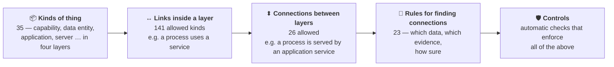

# The metamodel in plain words

> **Status: current (v0.22.1)** — what SDEM's metamodel contains and how to read it. The full, generated detail is in [`reference/`](reference/README.md); you do not need it to use SDEM.

The **metamodel** decides what SDEM will accept. Every record and every connection is checked against it, and SDEM refuses anything that breaks it. It lives in the `metamodel/` and `schema/` folders, and only the SDEM owner changes it ([how a change is made](sdem-administration.md#when-the-metamodel-changes)).

## What the metamodel says

These are SDEM's core (metamodel 0.20.0) — the same for every industry. An extension adds to them: [what BIAN adds](#what-an-extension-adds--bian).

An organisation adds its own kinds of thing, fields, rules and names **on top** of this metamodel with a profile ([`sdem-profile-spec.md`](design/sdem-profile-spec.md)) — never by editing it. `sdem model integrity --workspace <ws>` prints these figures for the metamodel a design uses.

## The kinds of thing, by layer

| Layer | Kinds of thing | Examples |
|---|---|---|
| **A1 · Business** (13) | what the business does and who does it | capability, value stream and stage, process, activity, business service, business object, event, interface, actor, role, product, requirement |
| **A2 · Data** (3) | the information the design keeps | data domain, data entity, data attribute |
| **A3 · Application** (7) | the systems that do the work | application component, service, function, interface, API operation, event, solution building block |
| **A4 · Technology** (12) | where the systems run | node, device, system software, network, path, technology service and interface, deployment, deployment environment, artifact, network zone, location |

Plus one *abstract* kind (A4 infrastructure component) that groups the technology an application can run on. A4 is the physical deployment — zones, connections, rules and the 3D view: [A4: the physical deployment](sdem-a4-physical-deployment.md).

## The connections between layers

Only these 26 are allowed. Each needs **evidence of a named kind** before a person can approve it.

| From | Connection | To | Evidence needed |
|---|---|---|---|
| A1 process, actor or role | is **served by** | A3 application service | process model |
| A1 process | is **automated by** | A3 application function | process model |
| A1 business service | is **realised by** | A3 application service or component | application architecture document |
| A1 business event · business interface | is **realised by** | A3 event · application interface | event design · application architecture document |
| A1 business object | is **mapped to** | A2 data entity | data model |
| A2 data entity | is **accessed by** | A3 application component, function, service, event or API operation | application architecture document |
| A2 data entity | is **stored in** | A4 artifact or system software | deployment design |
| A3 application component | is **deployed on** · **deployed as** | A4 node, device or system software · A4 deployment | deployment design |
| A3 application component or function | is **served by** | A4 technology service | deployment design |
| A3 application interface | is **exposed through** | A4 node, device or system software that is internet facing | network design |
| A3 application component | is **built as** | A4 artifact — its image or package | build pipeline |

## What an extension adds — BIAN

An extension adds kinds of thing, links and rules beside the core's, without changing them ([Extensions guide](sdem-extensions-guide.md)). **`sdem-bian`**, for banking designs, adds a layer between Business and Application — **Service Domains (BIAN)**, so the layers become A1 Business, A2 Service Domains, A3 Data, A4 Application, A5 Technology:

- **15 kinds of thing** — business area and domain, service domain, service operation, control record, business object, business scenario, semantic API …;
- **7 kinds of connection** to the other layers — a capability *supported by* a service domain, a process *using* one, a service domain *realised by* an application, a service operation *implemented by* an API operation, a BIAN business object *mapped to* a data entity …;
- **46 rules** for finding them, and BIAN 14's catalogue of 258 service domains.

A design that uses BIAN needs `sdem-bian` installed (SDEM 0.22, R-D2); one that does not is a core design.

## Four things that look alike

| | **Metamodel** | **Rules for finding connections** | **The registry** | **The formats (schemas)** |
|---|---|---|---|---|
| In one word | **types** | **rules** | **real connections** | **form** |
| Says | an A3 application component *may be* deployed on an A4 node | *how* to find that: the component's `deployed_on` names the node; high confidence; needs a deployment design | *this* component *is* deployed on *this* server — approved by Jane | which fields a connection record must have |
| Example | `DEPLOYED_ON` | `S33` | `MAP-002` | `relationship-registry.schema.json` |
| Changed by | the SDEM owner | the SDEM owner | the engine proposes; a person approves | the SDEM owner |

**Quick test:** a real thing like `APP-BOOK` → the registry. A rule with a step, a confidence and the data it needs → the rules. An allowed kind of link with no rule → the metamodel. A list of fields → a schema.

## How sure SDEM is

Every proposed connection says how sure the engine is — **high**, **medium** or **low** — and why: the rule it used, the data that matched, the published source behind the rule. **Nothing is approved automatically.** A record suggested from a design document (onboarding) is never above *medium*, and a connection to one never above *low* until it is confirmed; a planned (AID) one never above *medium*, and never real data.

## How the metamodel changes — the stability policy

SDEM's core — its kinds of thing, the connections between layers, the rules inside each layer, the attributes — changes only for a reason (a new release of a standard, a proven error, or the owner's decision on evidence of use), always with a new metamodel version, a recorded migration and the owner's approval, and never by removing something without first marking it deprecated. Your organisation's own needs go into a profile instead ([`sdem-profile-spec.md`](design/sdem-profile-spec.md)). CI holds the core to its last freeze (`metamodel/stability.json`). To see what is not yet settled: `sdem model status`; what your workspaces use: `sdem model usage --root workspaces`. Detail: [`sdem-metamodel-stability.md`](design/sdem-metamodel-stability.md).

## The controls — what SDEM refuses

| What it protects | Controls | SDEM refuses … |
|---|---|---|
| **Records** | CTL-01 … 04, 24 | an unknown kind of thing; a wrong or missing attribute; a link inside a layer that the metamodel does not allow; a record that does not match its format; a BIAN record taken from a design document instead of a BIAN source (with `sdem-bian`) |
| **Connections** | CTL-05 … 08 | a connection that is not one of those allowed; an approval with no reviewer, date or evidence; any edit to an approved connection (it is superseded instead); a connection to a record that does not exist |
| **People in charge** | CTL-21, 20, 23 | an approval by an agent; a change without the person behind it; an onboarded design that a person has not loaded |
| **The engine** | CTL-09, 10, 22 | an engine that finds fewer right connections than the tested runs; output that is not *proposed*; a rule that is not in the metamodel |
| **The metamodel itself** | CTL-11 … 14 | an item without its source and reasoning; a confidence that breaks the rule; a generated document out of date; any change to the owner's frozen specification |
| **The knowledge graph** | CTL-15 | building it from data that fails a check (the last good one is kept) |
| **Planning (AID)** | CTL-16, 17 | a planned design entering real data; a planned element above medium confidence |
| **Agents** | CTL-19 | an agent changing a layer that is not its own |

Every control, where it runs and its last test result: [controls register](reference/controls-register.md).

## The architecture model in numbers

The same numbers appear in the [rules specification](design/relationship-rules-spec.md) and the [model diagram](design/architecture-model-diagram.puml); a test keeps all three in step with the records. They are SDEM's core (metamodel 0.20.0): BIAN's types, rows, rules and join keys are the `sdem-bian` extension's since SDEM 0.22 (BX-15) — installed, it adds them.

| What | Count | Where in the spec | In the diagram |
|---|---|---|---|
| Entity types (boxes) | 36 | §2 | every box |
| Within-level rows: links allowed *inside* one architecture | 141 | §3.1 (`RA…`) | thin grey arrows |
| Relationship type catalogue: kinds of link allowed *between* architectures | 15 | §4.1 | named on the blue arrows |
| Plan rows: rules for finding cross-level relationships | 23 | §4.2 (`S…`) | — |
| …of which drawn as cross-level rules | 22 | §4.3 | coloured arrows |
| …of which catalogue rules, the only ones that produce registry records | 2 | §4.3 | blue arrows |
| Join keys the rules read from the architecture datasets | 40 | §5 (`K…`) | — |
| Inference engine requirements | 25 | §10 (`REQ-…`) | — |

## Reading the architecture-model diagram

[`architecture-model-diagram.puml`](design/architecture-model-diagram.puml) draws the metamodel (kinds of thing and the links allowed inside a layer) and the rules for finding connections. It does **not** draw any real connection. (Open it with the PlantUML extension in VS Code; it renders on your machine.)

| On the diagram | Means |
|---|---|
| A box, e.g. `A3.APIOperation` | a **kind** of thing — no real record like `API-PI-01` appears |
| Four columns | the four architectures, A1 to A4 |
| Thin grey arrow, e.g. `RA3-27 composition` | a link allowed **inside** a layer |
| Blue arrow, e.g. `S33 DEPLOYED_ON` | a rule the engine uses to **propose a connection** |
| Green, orange, dashed or dotted arrow, e.g. `S20` | another rule: reported as a hint, never a connection |
| Grey box | a kind of thing with no rule between layers, by decision |

To see which connections *do* exist, open a workspace's `mappings.json`, or run `sdem trace`.

## Where the metamodel comes from

Every entity type comes from a **published reference architecture** — ArchiMate 3.2 or TOGAF 10 in the core, BIAN (publicly available) in `sdem-bian` (published by The Open Group; sign-in required) — or is a documented SDEM extension of one; none is copied from any institution's model, and no BIAN or Open Group text is reproduced ([provenance, entity by entity](reference/reference-architecture-provenance.md)). BIAN®, ArchiMate® and TOGAF® are trademarks of their owners; SDEM is independent and not endorsed by them.

**Rules of use.** Keep historical designs; never overwrite or silently reclassify them. Keep BIAN reference content separate from your own design objects. A connection is a versioned, typed claim with evidence — an AI confidence value is not evidence. *Affected by a change* does not mean *must change*: impact needs an architect's assessment.

## The formal names

The specifications use formal names; in plain words they are:

| Plain words (this guide) | Formal name |
|---|---|
| the metamodel | **Architecture Metamodel** |
| the rules for finding connections | **Architecture Relationship Rules Model** |
| the engine (`sdem link`) | **Architecture Relationship Inference Engine** |
| the registry — approved connections (`mappings.json`) | **Architecture Relationship Registry** |
| the connections between layers | **relationship type catalogue** |
| one layer's records as a graph · all four joined | **local** · **federated architecture knowledge graph** |
